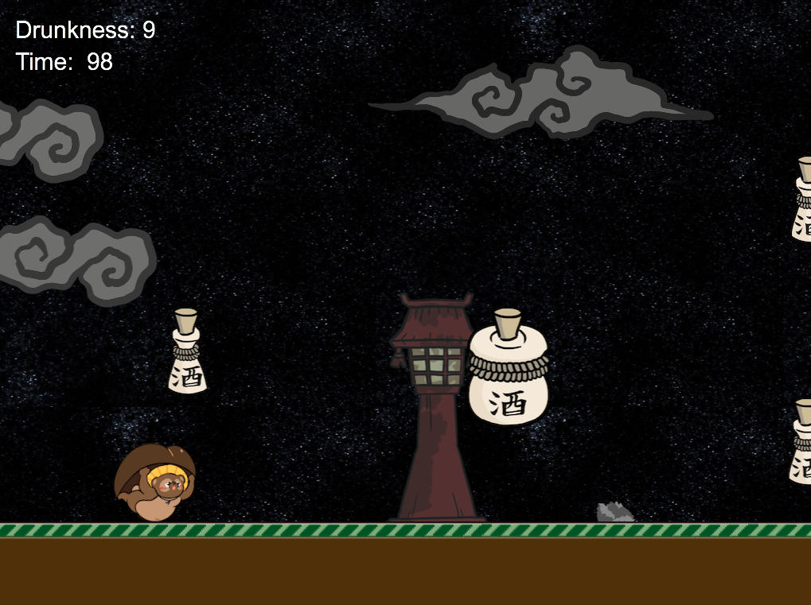
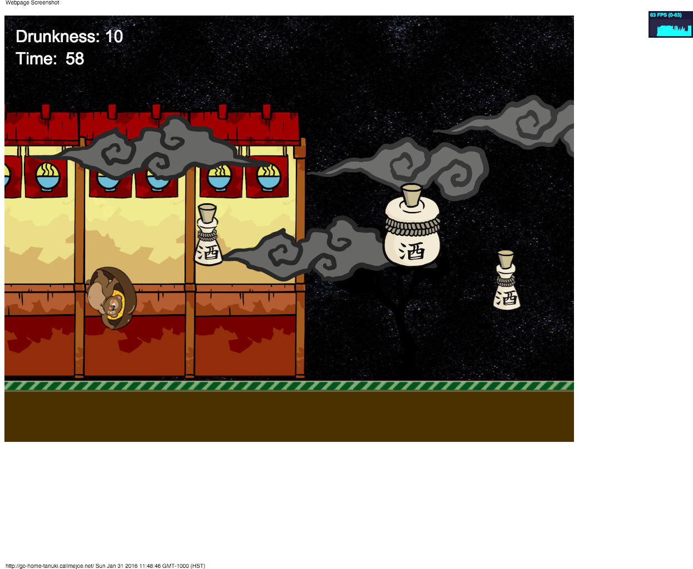
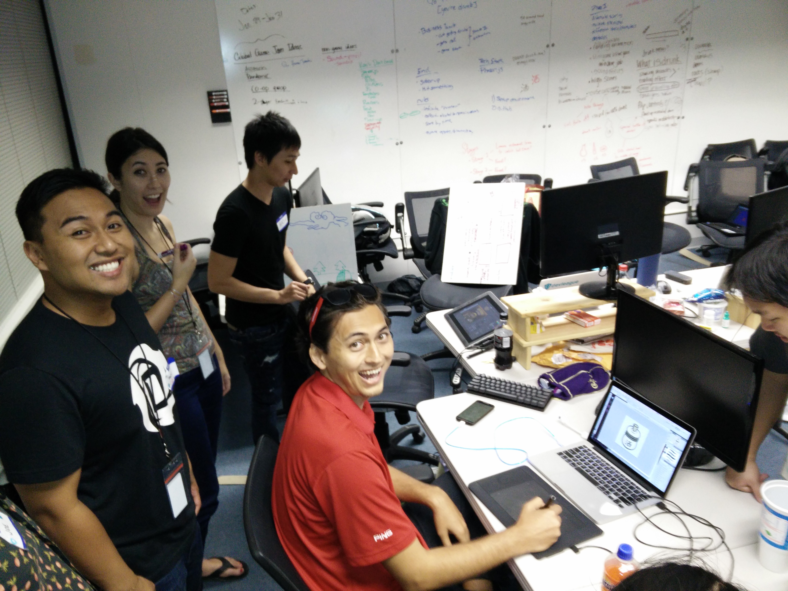

# Go Home Tanuki (You're Drunk)

### A Phaser.js Game

The fox-like Tanuki often appears in Japanese folklore as a shape-shifter with supernatural powers and mischievous tendencies, and is the protagonist of our game.

Go Home Tanuki (You're Drunk) was created at Global Game Jam 2016 and uses the theme "Ritual" to exemplify the results of a demanding work ethic common in Japan. Tanuki spends his days working, drinking, going home, repeat - and the player's job is to make sure he gets home safely, at least for tonight.

## Recording (November 2026)


What Go Home Tanuki looked like in November 2026, recorded for [its page on joekarlsson.com](https://www.joekarlsson.com/work/go-home-tanuki/). The full-quality video is [2026-11-recording.mp4](.github/readme/2026-11-recording.mp4).

## 🎮 Play the Game

Play the game at: [https://tanuki.joekarlsson.com/](https://tanuki.joekarlsson.com/)


## 📸 Game Screenshots





[Check out our gameplay footage here](https://youtu.be/7DED6sdNvCY)

## 🚀 Getting Started

### Prerequisites

- [Node.js](https://nodejs.org/) 22 or higher

### Installation

```bash
git clone https://github.com/JoeKarlsson/go-home-tanuki
cd go-home-tanuki
npm install
npm run dev
```

The game runs at `http://localhost:3017/`.

## 🧪 Testing

```bash
npx playwright install chromium firefox webkit   # once
npm test
```

The tests build the site, serve it, and play it in Chrome, Firefox and Safari (WebKit) on a desktop, plus Android and iPhone: metadata, accessibility (axe), a full round, audio starting from a key press, and the game embedded in another page the way joekarlsson.com shows it (it fits, game keys don't scroll the page, it pauses when scrolled out of view, and full screen works from inside the embed).

## 🧩 Embedding

The game is built to run in an iframe as well as on its own page. Give the iframe `allow="fullscreen; autoplay"` and `allowfullscreen` so the full-screen button and sound work. Embedded, it starts muted so nobody scrolling past is startled; the speaker button turns sound on. It scales to fit any frame, letterboxed; it pauses when scrolled out of view, and keeps the spacebar from scrolling the page around it.

## 🛠️ Available Commands

- `npm run dev`: development server with hot reload
- `npm run build`: production build in `dist/`
- `npm run preview`: serve the production build
- `npm run lint`: ESLint
- `npm run images`: redraw the icons and social card (build, start `npx vite preview --port 4173`, then run it)

## 📦 What's Inside

- **[Phaser CE 2.21](https://github.com/phaserjs/phaser-ce)**, the arcade-physics build, served with a content hash
- **[Vite 8](https://vitejs.dev/)**
- **[Playwright](https://playwright.dev/)** for tests
- Sprites in `public/images` are lossless WebP; the music and phone ring in `public/audio` are loudness-normalized MP3s

## 🚢 Deployment

Every push to `main` runs lint and the tests in GitHub Actions, then deploys `dist/` to GitHub Pages at [tanuki.joekarlsson.com](https://tanuki.joekarlsson.com/).

## 🤝 Contributing

1. Fork it!
2. Create your feature branch: `git checkout -b my-new-feature`
3. Commit your changes: `git commit -am 'Add some feature'`
4. Push to the branch: `git push origin my-new-feature`
5. Submit a pull request 🎉

## 👥 Created By

- [Joe Karlsson](https://www.joekarlsson.com/)
- Corina Jacobson
- [Sarah Kurisu](https://github.com/skurisu)
- [Kent Salcedo](https://github.com/kentsalcedo)


## 🎨 Art By

- Bao Nguyen
- Gabe



## 📄 License

The MIT License (MIT)

Copyright (c) 2025 Joe Karlsson

Permission is hereby granted, free of charge, to any person obtaining a copy
of this software and associated documentation files (the "Software"), to deal
in the Software without restriction, including without limitation the rights
to use, copy, modify, merge, publish, distribute, sublicense, and/or sell
copies of the Software, and to permit persons to whom the Software is
furnished to do so, subject to the following conditions:

The above copyright notice and this permission notice shall be included in all
copies or substantial portions of the Software.

THE SOFTWARE IS PROVIDED "AS IS", WITHOUT WARRANTY OF ANY KIND, EXPRESS OR
IMPLIED, INCLUDING BUT NOT LIMITED TO THE WARRANTIES OF MERCHANTABILITY,
FITNESS FOR A PARTICULAR PURPOSE AND NONINFRINGEMENT. IN NO EVENT SHALL THE
AUTHORS OR COPYRIGHT HOLDERS BE LIABLE FOR ANY CLAIM, DAMAGES OR OTHER
LIABILITY, WHETHER IN AN ACTION OF CONTRACT, TORT OR OTHERWISE, ARISING FROM,
OUT OF OR IN CONNECTION WITH THE SOFTWARE OR THE USE OR OTHER DEALINGS IN THE
SOFTWARE.
